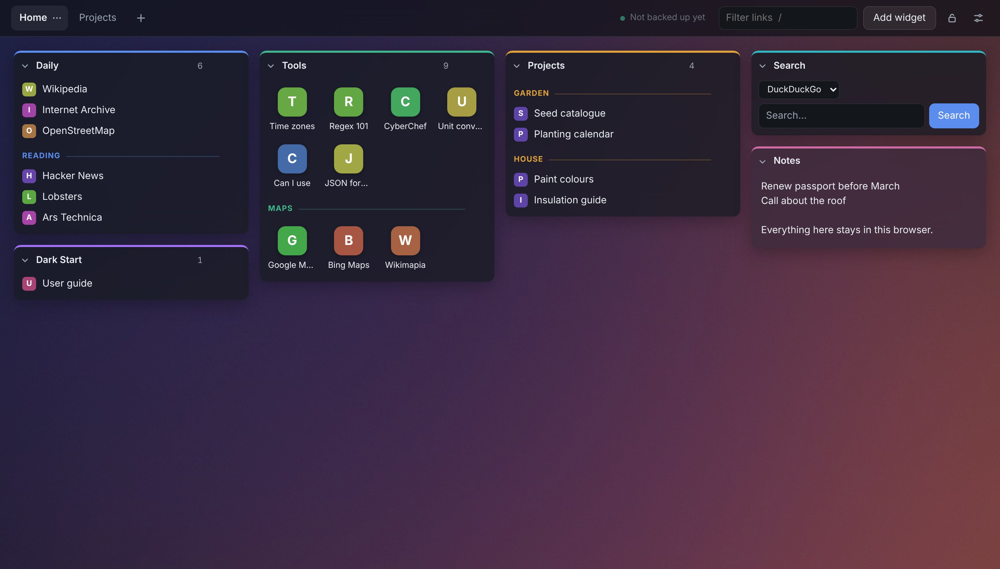

# Dark Start

**A private start page that keeps your bookmarks to yourself.**

Dark Start is a start page for the browser: tabs of link groups, search boxes and sticky notes that you arrange by dragging. It works like the popular hosted start pages, with one big difference: **your links, notes and layout never leave your browser.** There are no accounts, tracking or analytics, and nothing on the page is fetched from anyone else's server.

It's plain HTML, CSS and JavaScript. There's no build step, no framework, no dependencies and no backend. Put the folder on any web server and it works.

Live at **[darkstart.net](https://darkstart.net)**.



---

## Why it exists

Hosted start pages store every link, page title and note you create on their servers, along with where you connect from. For most people that's fine. For anyone whose bookmarks reveal their work, interests or investigations, that list is a detailed profile.

Dark Start was built for a team that needed a start page without that profile, and is now shared for anyone who wants the same.

## Features

- **Pages and columns.** Tabs you can reorder and rename, with 1 to 6 columns per page.
- **Three widget types:**
  - **Links**, shown as a list or as a grid of icons, with optional section headings and dividers;
  - **Search**, using any engine you like, with nothing sent until you press Enter;
  - **Notes**, sticky notes that save as you type.
- **Drag and drop everything:** widgets between columns, widgets onto other tabs, and links between widgets.
- **Backgrounds:** built-in images, your own uploads, darken and blur controls, and light or dark widgets.
- **Backup and restore** to a single file, with a **backup status** that brightens as un-backed-up changes age.
- **Sharing:** export a page or widget for a friend, who imports it alongside their own.
- **Bookmark import** from any browser's bookmarks HTML export. Each folder becomes a widget.
- **A shared library** of ready-made widgets that the site owner keeps in plain JSON files.
- **Filter** across the current page, with keyboard shortcuts. **Lock** the layout to prevent accidental moves.
- **A built-in user guide** (`guide.html`), styled to match.

## Privacy by design

| Dark Start... | Because... |
|---|---|
| stores everything in the browser (IndexedDB) | the server never receives your links, notes or searches |
| loads nothing from other servers: a strict Content-Security-Policy allows files from this site only | no CDNs, web fonts, analytics or remote images can sneak in |
| shows coloured letter badges instead of site icons | fetching favicons from Google or DuckDuckGo would hand them your whole link list |
| sends no `Referer` header (`no-referrer` everywhere) | sites you visit can't see where the click came from |
| turns off DNS prefetching | your link list isn't looked up in advance by your DNS provider |
| never fetches link titles or previews | a site only hears from you when you click it |
| sends nothing to a search engine until you press Enter, and opens results with no opener and no referrer | no keystroke-by-keystroke suggestions |
| turns spellcheck off in notes | "enhanced" spellcheck in some browsers sends what you type to Google or Microsoft |
| re-encodes uploaded backgrounds | strips EXIF and GPS metadata before images are stored or backed up |
| accepts only `http`, `https`, `mailto` and `ftp` links | `javascript:` and `data:` links are rejected, including in imported files |

**What it can't do:** your web host still sees that someone loaded the page, as with any website. Search engines still see your searches, and the sites you visit still see your connection. See [docs/privacy.md](docs/privacy.md) for the full picture.

## Quick start

**Try it locally.** Browsers won't let the page load its settings from a `file://` address, so serve it instead:

```sh
git clone https://github.com/<you>/darkstart.git
cd darkstart
python -m http.server 8080
# open http://localhost:8080
```

**Host it.** Upload the files to any static web host. Ready-made security headers are included for:

| Host | File |
|---|---|
| Apache, LiteSpeed (most shared hosting) | `.htaccess` (included at the root) |
| IIS | `web.config` (included at the root) |
| nginx | [`deploy/nginx.conf`](deploy/nginx.conf) |
| Netlify, Cloudflare Pages | [`deploy/_headers`](deploy/_headers) |
| GitHub Pages | works as is; see the notes in [docs/hosting.md](docs/hosting.md) |

Serve it from **one address only** (for example `https://example.org`, with `www.` and `http://` redirecting to it). Browsers keep a separate setup for each address, so people would otherwise lose track of their pages.

Full details are in **[docs/hosting.md](docs/hosting.md)**.

## Make it yours

Everything a site owner changes is in plain files. No code changes needed.

| File | Controls |
|---|---|
| `config.json` | Site title, built-in backgrounds, search engines and the default engine, the library list, and the backup reminder period |
| `defaults/layout.json` | What a first-time visitor sees |
| `library/*.json` | Ready-made widgets people can add from **Add widget** |
| `backgrounds/` | Built-in background images and thumbnails |
| `guide/` | Screenshots for the user guide. Drop in images with the names in `guide/README.txt`. |

See **[docs/customising.md](docs/customising.md)** and **[docs/file-formats.md](docs/file-formats.md)**.

## Where people's data lives

Each person's setup is saved in **their own browser, on their own computer**, filed under the site's exact address. That has three consequences:

- **It doesn't follow people between browsers or computers.** Backup and restore is how they move it.
- **Clearing browser data deletes it.** The backup status in the top bar nudges people to download a backup.
- **Strict browser policies can wipe it every session.** On managed machines where cookies are set to "session only", everything is cleared when the browser closes. An administrator can exempt the site with the `CookiesAllowedForUrls` policy (Edge and Chrome).

## Browser support

Current versions of Edge, Chrome, Firefox and Safari. Development and testing have been done mainly in Chromium-based browsers. Reports from Firefox and Safari users are welcome.

## Contributing

Issues and pull requests are welcome. Please read **[CONTRIBUTING.md](CONTRIBUTING.md)** first: the project has a few firm rules, such as no external requests, no dependencies and no build step, and they're the point of it.

Security or privacy problems: see **[SECURITY.md](SECURITY.md)**.

## Licence

[MIT](LICENSE).

Dark Start is an independent project and is not affiliated with start.me or any other start page service.
